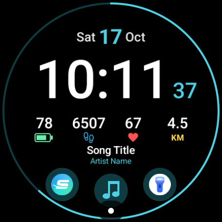
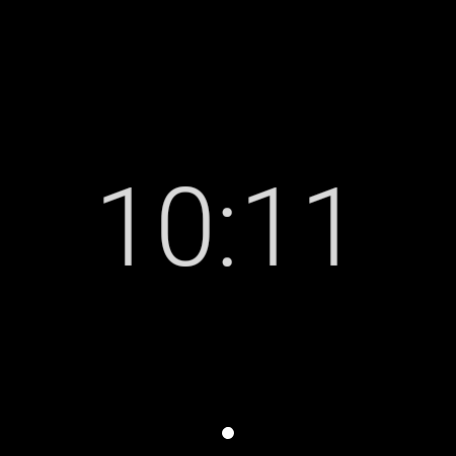

# PixelFace

A digital watch face for Pixel Watch 3 (Wear OS 5 or newer).

It shows time with seconds, date, battery, steps, heart rate, today's distance and the
currently playing track. It has three tap buttons: torch, media controls and Swim.com.

| Watch in use | Always-on |
|:---:|:---:|
|  |  |

Screenshots are from a Pixel Watch 3. The track shown is a test track.

## Project layout

| Module | What it is |
|---|---|
| `watchface` | The watch face, written in Watch Face Format v2 (XML only, no code). Layout lives in `watchface/src/main/res/raw/watchface.xml`. |
| `companion` | Small Kotlin app, "PixelFace Data". It provides two complications the format cannot do on its own: today's distance (from Health Services) and now playing (from media sessions). |

## Install on the watch

Download `pixelface-watchface-<version>.apk` and `pixelface-data-<version>.apk` from the
[Releases](https://github.com/jimlinx/pixel-watchface/releases) page, or build them yourself (see below).
You need the Android SDK platform tools (`adb`) on your computer.

1. On the watch, open Settings > System > About > Versions and tap Build number 7 times.
2. Open Settings > Developer options. Turn on ADB debugging and Wireless debugging.
3. In Wireless debugging, tap "Pair new device" and note the pairing code, IP and port.
4. From the computer (the watch and computer must be on the same Wi-Fi):

```sh
adb pair <ip>:<pairing-port>          # enter the pairing code
adb connect <ip>:<debug-port>         # port shown on the Wireless debugging screen
adb install -r pixelface-data-<version>.apk
adb install -r pixelface-watchface-<version>.apk

# Now-playing needs notification access. Wear OS has no settings screen for it, so grant it here:
adb shell cmd notification allow_listener com.jimlin.pixelface.companion/com.jimlin.pixelface.companion.MediaListenerService
```

If adb says "more than one device", add `-s <serial>` from `adb devices`, or set `ANDROID_SERIAL`.

5. On the watch, open the "PixelFace Data" app and tap "Allow distance".
6. Long-press the current watch face, swipe to "Add", and pick PixelFace.

## Build

Open the folder in Android Studio, or from a terminal:

```sh
JAVA_HOME=/opt/homebrew/opt/openjdk@21 ./gradlew assembleDebug     # debug, includes the test-track receiver
JAVA_HOME=/opt/homebrew/opt/openjdk@21 ./gradlew assembleRelease   # release, shrunk
```

APKs land in `watchface/build/outputs/apk/<type>/` and `companion/build/outputs/apk/<type>/`.

Release builds are signed with the key described in `~/.android/pixelface-release.properties`
(`storeFile`, `storePassword`, `keyAlias`, `keyPassword`), or another file passed with
`-PpixelfaceSigning=<path>`. Without that file they fall back to the debug key.
A debug build and a release build can't replace each other on a watch, because their signatures
differ. Uninstall one before installing the other.

## Set up the shortcuts

Long-press the face and tap "Edit". Then:

- **Left button**: choose "App shortcut", then Flashlight.
- **Right button**: choose "App shortcut", then Swim.com.
- **Middle button**: fixed. It opens the system media controls.
- **Distance** and **Now playing** default to PixelFace Data. If they show empty, pick
  "PixelFace Data" for those slots.
- **Accent color**: cyan, lime, orange or pink.

Tapping the track title opens the media controls, the same as the middle button.

## Notes

- Distance is shown in kilometres.
  Health Services batches updates, so it can lag a few minutes behind.
- Heart rate is blank until the watch has a reading. The watch asks for sensor permission
  the first time the face is used.
- Phone media: the companion reads media sessions on the watch, and media notifications
  as a fallback. Whether phone playback appears depends on how Wear OS bridges it on your
  watch. Watch-side players (YouTube Music, Spotify on the watch) always work.

## Testing without a music app (debug builds only)

```sh
ADB=~/Library/Android/sdk/platform-tools/adb
$ADB shell am broadcast -a com.jimlin.pixelface.FAKE_MEDIA -p com.jimlin.pixelface.companion --es title "Test" --es artist "Artist"
$ADB shell am broadcast -a com.jimlin.pixelface.FAKE_MEDIA -p com.jimlin.pixelface.companion --ez stop true
```

## Validate the watch face XML

Google's validator lives in https://github.com/google/watchface. Build it with
`./gradlew :specification:validator:executable-jar` in `third_party/wff`, then:

```sh
java -jar wff-validator.jar 2 watchface/src/main/res/raw/watchface.xml
```

## Credits

The heart and footprint icons are from [Material Symbols](https://github.com/google/material-design-icons) by Google, licensed under Apache 2.0.

The always-on time uses [Roboto](https://github.com/googlefonts/roboto-3-classic) Light, licensed under the SIL Open Font License 1.1. See `FONT-LICENSE-Roboto.txt`.
